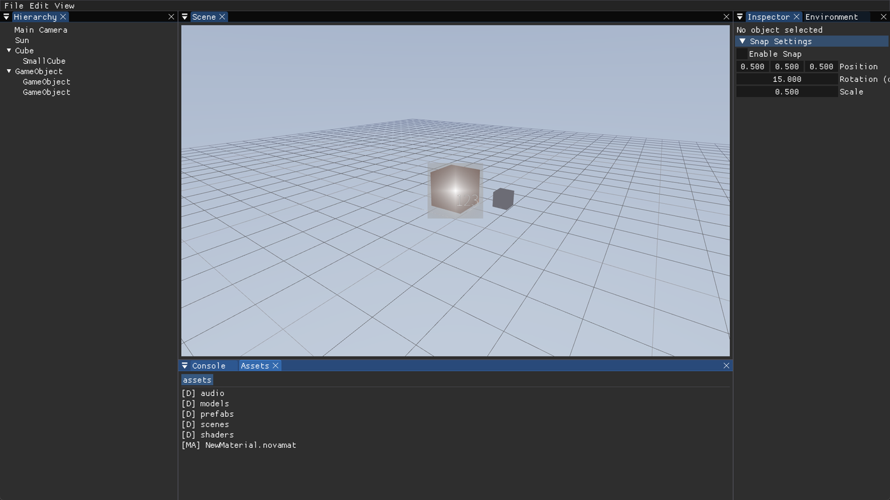

# NovaEngine 🚀

> 一个 C++20 编写的 Mini 3D 游戏引擎 + Unity 风格游戏编辑器。
> 自己写引擎底层、AI 辅助开发,做出能创建、编辑、运行、打包 3D 游戏的完整工具。




## 🎮 示例游戏:霓虹收集者(Neon Collector)

科幻霓虹风 3D 收集闯关——大厅选关 → 关卡内跑跳收集能量晶体 → 集满激活终点拱门 → 通关计时评级。核心玩法:**Shift 冲刺**、**二段跳**、**连击 Combo**(2.5s 窗口,音效逐级升高)、**S/A/B/C 通关评级**、**检查点复活**、**幽灵回放**(刷新纪录后与自己的最佳轨迹竞速)、**隐藏晶体**、**空中捷径**、**本地排行榜**;主题「维度突破」——每收集一颗晶体,对应路线灯带点亮、世界随进度渐亮,集满后整个关卡恢复霓虹能量。展示引擎全功能:多场景异步切换、角色控制器、Shader Graph 自发光材质、LUT 冷色调、粒子、运行时 UI 计分、BGM 与拾取音效、场景参数传递、发布打包。

- 大厅场景:`assets/scenes/NeonLobby.nova.json`
- 关卡场景:`assets/scenes/NeonLevel1.nova.json`
- 玩法脚本:`samples/NovaSampleGame/`(NeonGameManager / NeonLobbyUI / NeonLevelHud / NeonCollectible / NeonGate / NeonPlayerWatcher)

## ✨ 特性

**编辑器(Unity 风格)**

- 面板布局:Scene Hierarchy / 3D Scene View / Inspector / Console / Asset Browser + Environment(环境)、Profiler、Shader Graph、Physics Layers、Reference Checker、Mixer 等
- 场景编辑:点选 / Ctrl 加选 / W·E·R·X gizmo(位移·旋转·缩放·Local/World 切换)/ 吸附 / 多选批量编辑 / F 聚焦
- 拖拽 `.obj` / `.fbx` / `.gltf` 模型进场景,重复导入走二进制缓存秒进
- 路径字段「…」浏览按钮:原生文件选择框(LUT / Cubemap / Mesh / 材质资产 / 贴图 / Shader Graph 资产)
- Play 模式(Ctrl+P):快照进出、游戏分辨率与 Render Scale、运行时 UI 输入
- Undo/Redo 全链路(场景编辑 + 资产文件级撤销)
- 中文路径资产、文件日志 + 崩溃兜底
- 按键调试日志:`NOVA_DBG_KEYS=1` 启动时逐键输出「按下 XX 键」(Console 面板/终端可见)

**渲染**

- PBR 材质(金属度/粗糙度工作流)+ 方向光阴影 + 天空盒(渐变/HDRI)+ 透明混合
- 后处理链:Bloom + ACES 色调映射(HDR 16F 中间缓冲,老显卡自动降级直通)
- 色彩分级:LUT 3D 查找表(.cube,冷暖氛围)+ 景深 DOF + 渐晕 + 胶片颗粒
- Shader Graph:可视化节点编辑器(17 节点集),连线生成 GLSL,编译错误定位到节点
- 地形(高度图/笔刷)、蒙皮动画(状态机)、2D 精灵、粒子、IBL/SSAO
- HiDPI 适配(150% 缩放显示器文字清晰不发虚)

**游戏系统**

- 物理:Jolt Physics——刚体、盒/球/胶囊/网格碰撞体、触发器、kinematic、固定步进
- 角色控制器:胶囊体 WASD 行走 + 跳跃 + 楼梯步进 + 坡度限制 + 层碰撞矩阵(Physics Layers 面板)
- 射线/形状查询:raycastAll / overlapSphere / overlapBox(完整命中信息)
- 多场景工作流:additive 场景加载/卸载(异步后台线程)、场景参数传递、DDOL 跨场景存活
- 音频:miniaudio——3D 空间音效、多总线混音器(滑条实时生效)、流式 BGM、淡入淡出
- 运行时 UI:Canvas / Button / Text / Image,锚点布局,支持中文字体
- 脚本:C++ 脚本组件(热重载 DLL),字段可序列化、Inspector 可调
- 协程 + 事件系统
- Prefab:创建 → 拖放实例化 → 字段 override 高亮 → Apply 全实例同步 → Revert
- 材质库:`.novamat` 共享材质资产,改一处、处处同步
- Profiler:帧时间线抓取回放、CPU 火焰图(脚本级)、GPU 各 pass 耗时、内存分类统计

**资产与发布**

- 纹理压缩:BC7/BC1/BC5(bc7enc)+ 批量导入(--import CLI),实测 40MB→13.3MB
- 引用完整性:AssetReferenceScanner 扫描 17 种引用形态、打包预检、移动资产自动重链
- 一键打包独立 exe:NovaPlayer + `.novapak` 单文件资源包,目标机无需开发环境
- 发布流水线:版本/图标(RC 元数据)、发行目录(README/steam 占位)、产物可复现(字节一致)
- 测试与 CI:NovaTests 73 项(Catch2)Debug/Release 双配置,GitHub Actions 全绿

## 🚀 快速开始

**环境要求**:Windows 10/11 · Visual Studio 2026(MSVC)· CMake 4.4+。第三方依赖全部经 CMake FetchContent 自动拉取,无需手动安装(构建期 glad 生成器需要 Python + jinja2:`pip install jinja2`)。

```bash
# 配置(首次编译 Assimp 需数分钟,属正常现象)
cmake -S . -B build

# 编译编辑器(或 cmake --build build 全量)
cmake --build build --config Debug --target NovaEditor

# 运行编辑器
build/editor/Debug/NovaEditor.exe
```

其余产物:

| Target | 产物 | 说明 |
|---|---|---|
| NovaPlayer | `build/player/Debug/NovaPlayer.exe` | 打包运行时播放器(`--scene/--pak/--width/--height` 参数) |
| NovaTests | `build/tests/Debug/NovaTests.exe` | Catch2 单元测试(73 项,`ctest --test-dir build -C Debug`) |

Release 构建:`cmake --build build --config Release`。

## 📖 使用

**编辑器**

- `Ctrl+N` / `Ctrl+O` / `Ctrl+S` 新建 / 打开 / 保存场景(`.nova.json`,JSON 文本可读)
- 场景视口右键创建物体(Cube/Sphere/Plane/Camera/Light/UI 等),拖拽成父子层级
- `W` 位移 / `E` 旋转 / `R` 缩放 / `X` 切换 Local/World;按住 Ctrl 拖动 = 吸附
- 右键拖拽旋转视角、中键拖拽平移、滚轮缩放;按住右键 + WASD 飞行(Shift 加速)
- `Ctrl+P` Play / Stop
- 菜单:Window → Profiler / Shader Graph / Physics Layers;Assets → Reference Checker;Audio → Mixer
- 色彩分级:Environment 面板 Color Grading 区——LUT 点「…」选择 .cube + Intensity 滑条、DOF/渐晕/颗粒开关
- `File → Build Player...` 打包独立 exe;`--build --release` 出发布目录(版本/图标/README)
- 脚本:挂 `SpinningCube`(可调 speed)、`CharacterWalk`(WASD+跳跃)、`SceneLoadDemo`(数字键异步切场景)

**播放器**

```bash
build/player/Debug/NovaPlayer.exe --scene assets/scenes/demo.nova.json
# 打包产物:exe 同目录放 .novapak 自动挂载,双击即玩
```

**示例场景**:`demo`(PBR+阴影+UI)· `V10CharacterDemo`(角色控制器:楼梯/斜坡/阻挡台)· `V10MultiSceneDemo`/`V10AdditiveLevel`(多场景异步切换 + Shader Graph 示例球)· `PhysicsTest`(刚体下落)· `NeonLobby`/`NeonLevel1`(示例游戏《霓虹收集者》)

## 📁 项目结构

```
engine/    引擎核心(渲染 / 物理 / 音频 / UI / 脚本 / 序列化 / 资产 / ShaderGraph / Profiling)
editor/    Unity 风格编辑器(ImGui 面板)
player/    打包运行时播放器(无编辑器依赖)
samples/   示例脚本(编译进编辑器与播放器;含示例游戏玩法脚本)
assets/    示例场景与资产(models / scenes / audio / luts / shadergraphs)
tests/     无头回归测试(Catch2,NovaTests 73 项)
docs/      架构 / 功能 / 路线图文档
```

## 🗺 路线图

- ✅ M1–M5:窗口+渲染+五面板 → 模型渲染+层级 → 编辑交互 → 序列化 → Play 模式
- ✅ V0.2:阴影 / 天空盒 / Undo-Redo / 统计面板 / 透明渲染 / 打包
- ✅ V0.3:PBR 材质库 / 物理 / 音频 / 运行时 UI / 协程事件 / 后处理 / 场景管理 / Prefab
- ✅ V0.5:LOD / IBL / SSAO / 粒子 / 地形 / 动画状态机 / 2D / 热重载 / CLI 批处理
- ⏳ V1.0「商业独立游戏发布级」:Profiler / 多场景流式 / 角色控制器 / 色彩分级 / Shader Graph / 纹理压缩 / 引用完整性 / 音频混音器 / 测试+CI / 发布流水线——**波 1、波 2 已交付并人工验收完成;波 3(示例游戏《霓虹收集者》/ 编辑器细节 / 内存审计 / 文档化)进行中**
- 🔭 V2.0「领域扩展」(展望):皮肤系统 / Decal 贴花 / 贴图热重载 · URDF/STEP 机器人仿真(关节/传感器/headless 加速)

详见 [docs/ROADMAP.md](docs/ROADMAP.md)。

## 📚 文档

| 文档 | 内容 |
|---|---|
| [docs/ARCHITECTURE.md](docs/ARCHITECTURE.md) | 架构总纲(所有模块接口以此为准) |
| [docs/FEATURES.md](docs/FEATURES.md) | 功能使用手册(快捷键 / 面板 / 工作流) |
| [docs/ROADMAP.md](docs/ROADMAP.md) | 版本路线图与验收清单 |
| [docs/KNOWN-ISSUES.md](docs/KNOWN-ISSUES.md) | 已知问题与修复记录 |
| [docs/AGENTS.md](docs/AGENTS.md) | 多 Agent 开发流程 |
| [CLAUDE.md](CLAUDE.md) | 构建与开发约定 |

## 🤝 贡献

AI 辅助多 Agent 协同开发:Architect(方案)→ Coder(按模块并行)→ Reviewer(审查)→ DevOps(编译验证),流程见 [docs/AGENTS.md](docs/AGENTS.md)。

代码约定:类 `PascalCase`、方法 `camelCase`、成员 `m_` 前缀;注释用中文;引入新第三方库需 Architect 同意。

## 📄 许可证

尚未选择许可证。

## 💖 致谢

站在这些开源项目的肩膀上:

[GLFW](https://github.com/glfw/glfw) · [Dear ImGui](https://github.com/ocornut/imgui) · [ImGuizmo](https://github.com/CedricGuillemet/ImGuizmo) · [GLM](https://github.com/g-truc/glm) · [Assimp](https://github.com/assimp/assimp) · [Jolt Physics](https://github.com/jrouwe/JoltPhysics) · [miniaudio](https://github.com/mackron/miniaudio) · [stb](https://github.com/nothings/stb) · [nlohmann/json](https://github.com/nlohmann/json) · [Catch2](https://github.com/catchorg/Catch2) · [bc7enc_rdo](https://github.com/richgel999/bc7enc_rdo)
